# System Architecture: Delivery & Logistics Management System

This document outlines the high-level architecture, module decomposition, and external integration points of the web-based Delivery and Logistics Management System.

---

## Architecture Diagram

```mermaid
graph TD
    subgraph Client_Layer ["Client Layer (Browser)"]
        UI["Web Browser: Bootstrap 5, Custom CSS, Vanilla JS"]
        GMapsJS["Google Maps JavaScript API (Route Preview, Autocomplete)"]
        FCMWeb["Firebase Cloud Messaging Web SDK (Push Service Worker)"]
    end

    subgraph LavaLust_Core ["LavaLust MVC Core (PHP 8.1+)"]
        Router["Router / URL Dispatcher"]
        Middleware["Auth & CSRF Middleware (Deny-by-default, Throttling)"]
        
        subgraph Controllers ["Controllers (app/controllers/)"]
            C_Auth["Auth.php (Login, Register, Session)"]
            C_Orders["Orders.php (Create, Pay, Track, Cancel)"]
            C_Dispatch["Dispatch.php (Live Dispatch Board)"]
            C_Admin["Admin.php (Users, Riders, Rates, Reports, Logs)"]
            C_Webhooks["Webhooks.php (/webhooks/paymongo, /webhooks/lalamove)"]
        end

        subgraph Models ["Models & State Machine (app/models/)"]
            M_Order["Order_model.php (Enforces set_status & State Machine)"]
            M_User["User_model.php"]
            M_Rider["Rider_model.php"]
            M_Address["Address_model.php"]
            M_Payment["Payment_model.php"]
            M_Delivery["Delivery_model.php"]
            M_Setting["Setting_model.php"]
        end

        subgraph Services ["External API Services (app/libraries/)"]
            S_ApiClient["ApiClient.php (cURL, 10s Timeout, 2 Retries on 5xx/Timeout)"]
            S_GMaps["GoogleMapsService.php"]
            S_Lalamove["LalamoveService.php"]
            S_PayMongo["PayMongoService.php"]
            S_Semaphore["SemaphoreService.php"]
            S_FCM["FcmService.php"]
            S_Notif["NotificationService.php (Status Templates, SMS + Push Dispatch)"]
        end
    end

    subgraph Database_Layer ["Data Storage (MySQL / MariaDB)"]
        DB[(delivery_logistics DB)]
        T_Logs[("api_logs (Audit Trail)")]
        T_Webhooks[("webhook_events (Idempotency)")]
        T_Orders[("orders, deliveries, parcels, payments")]
    end

    subgraph External_APIs ["External REST Services"]
        API_GMaps["Google Maps Platform (Routes, Places)"]
        API_Lalamove["Lalamove Sandbox API (Quotation, Booking)"]
        API_PayMongo["PayMongo Checkout API (e-Wallets, Cards)"]
        API_Semaphore["Semaphore SMS API (Transactional SMS)"]
        API_Firebase["Firebase Cloud Messaging (FCM v1 HTTP)"]
    end

    subgraph Cron_Tasks ["Automated / Scheduled Jobs"]
        Cron_Retry["retry_failed.php (Runs every 5 mins)"]
        Cron_Backup["backup.sh (Daily DB Dump)"]
    end

    %% Client communication
    UI -->|HTTPS Requests| Router
    GMapsJS -.->|Interactive Map & Route| UI
    FCMWeb -.->|Token Registration| UI

    %% Routing to Controllers
    Router --> Middleware
    Middleware --> Controllers

    %% Controller to Model / Service flows
    Controllers --> Models
    Controllers --> Services
    M_Order -->|Invokes on status change| S_Notif

    %% Service inheritance & Logging
    S_GMaps -->|Extends| S_ApiClient
    S_Lalamove -->|Extends| S_ApiClient
    S_PayMongo -->|Extends| S_ApiClient
    S_Semaphore -->|Extends| S_ApiClient
    S_FCM -->|Extends| S_ApiClient
    S_Notif --> S_Semaphore
    S_Notif --> S_FCM

    S_ApiClient -->|Logs every attempt| T_Logs

    %% External API calls
    S_GMaps -->|cURL REST| API_GMaps
    S_Lalamove -->|cURL Signed HMAC| API_Lalamove
    S_PayMongo -->|cURL Basic Auth| API_PayMongo
    S_Semaphore -->|cURL HTTPS| API_Semaphore
    S_FCM -->|cURL OAuth2/JWT| API_Firebase

    %% Webhook ingest
    API_Lalamove -->|POST Webhook with Signature| C_Webhooks
    API_PayMongo -->|POST Webhook with Signature| C_Webhooks
    C_Webhooks -->|Check Idempotency| T_Webhooks
    C_Webhooks -->|Update Order Status| M_Order

    %% Models to Database
    Models --> DB
    DB --- T_Orders

    %% Cron executions
    Cron_Retry -->|Polls failed bookings| M_Order
    Cron_Retry -->|Triggers rebooking| S_Lalamove
    Cron_Backup -->|mysqldump| DB
```

---

## Architectural Principles & Constraints

1. **Layered Decoupling:** Controllers never call third-party APIs directly; all remote calls are encapsulated in dedicated service libraries extending `ApiClient`.
2. **Centralized State Transitions:** The `orders.status` state machine is strictly enforced by `Order_model::set_status()`. Every valid state change records a historical timeline event in `deliveries` and triggers `NotificationService`.
3. **Resilience & Fault Tolerance:**
   - 10-second cURL timeouts with 2 automated retries on 5xx or network timeouts.
   - Comprehensive audit logging of all outbound and inbound HTTP interactions in `api_logs`.
   - Webhook idempotency via `webhook_events` to guard against duplicate deliveries.
   - Non-blocking notification dispatch: failures in SMS or push notifications are logged and do not roll back transaction state.
4. **Security Hardening:**
   - Deny-by-default role authorization.
   - Output escaping via `htmlspecialchars` across all views.
   - CSRF protection enabled on state-changing forms.
   - Session regeneration upon successful authentication.
   - Sensitive credential isolation in `.env`.
